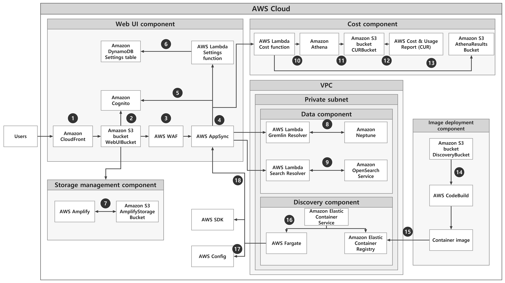
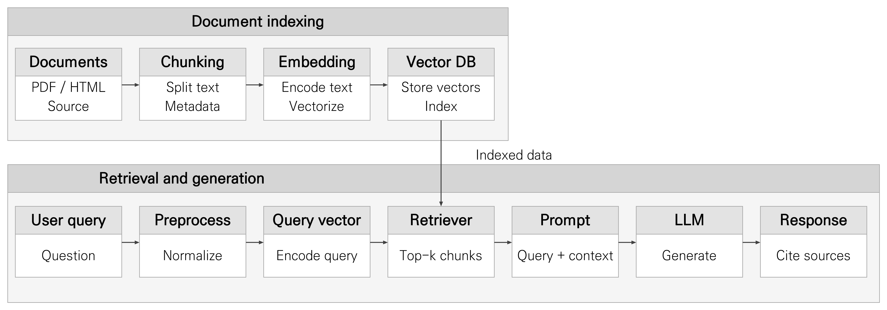

# report-diagram-ppt

이미지·텍스트를 보고서용 흑백 다이어그램으로 변환하는 AI 에이전트 스킬. 편집 가능한 **PPTX**와 고해상도 **PNG**를 생성합니다.

## 설치

```powershell
git clone https://github.com/tjsdn052/report-diagram-ppt.git "$env:USERPROFILE\.agents\skills\report-diagram-ppt"
```

## 사용

- `$report-diagram-ppt` 첨부 이미지와 동일한 구조의 도식 제작
- `$report-diagram-ppt` RAG 아키텍처를 보고서용 도식으로 제작

Windows PowerShell에서 JSON을 직접 렌더링할 수도 있습니다.

```powershell
.\render.ps1 -Spec .\examples\cicd\layout.json -OutputBase .\cicd
```

## 예제

| 예제 | 입력 | 결과 |
|---|---|---|
| AWS Workload Discovery | [이미지 출처](examples/aws/input.md) | [PPTX](examples/aws/diagram.pptx) · [PNG](examples/aws/diagram.png) |
| Client–Server | [이미지 출처](examples/client_server/input.md) | [PPTX](examples/client_server/diagram.pptx) · [PNG](examples/client_server/diagram.png) |
| 2-Tier Architecture | [이미지 출처](examples/two_tier/input.md) | [PPTX](examples/two_tier/diagram.pptx) · [PNG](examples/two_tier/diagram.png) |
| RAG | [텍스트](examples/rag/input.md) | [PPTX](examples/rag/diagram.pptx) · [PNG](examples/rag/diagram.png) |
| Apache Kafka | [텍스트](examples/kafka/input.md) | [PPTX](examples/kafka/diagram.pptx) · [PNG](examples/kafka/diagram.png) |
| CI/CD | [텍스트](examples/cicd/input.md) | [PPTX](examples/cicd/diagram.pptx) · [PNG](examples/cicd/diagram.png) |

### AWS · 이미지 기반



### RAG · 텍스트 기반


